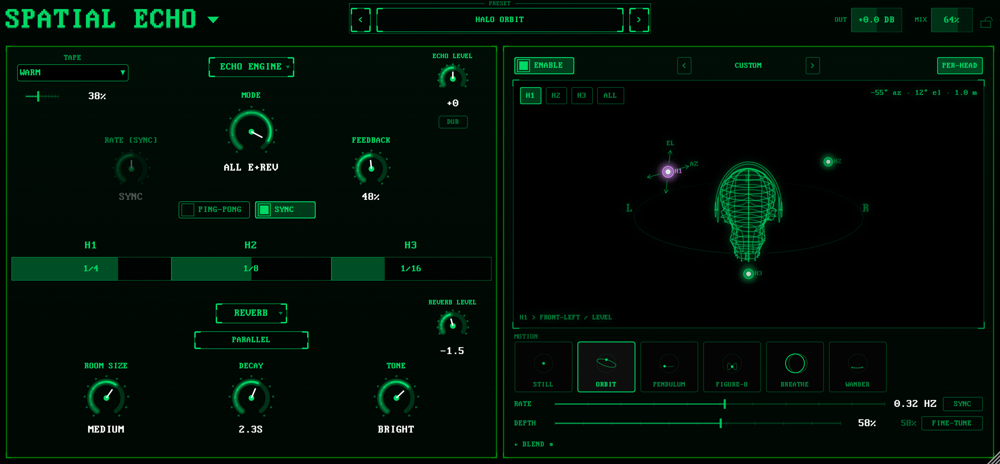

# Spatial Echo

Tape echo, reverb and headphone spatial rendering in one plug-in.
macOS (AU, VST® 3, Standalone) and Windows (VST3, Standalone).
Free to download and use. Source code under the MIT License.

**[Download the installers](https://echoeslabmusic.com/lab)** ·
[User guide](docs/user-guide.md) ·
[Build from source](docs/build-and-test.md) ·
[Known issues](docs/known-issues.md) ·
[Changelog](CHANGELOG.md)



## What it does

Spatial Echo chains a three-head tape delay, a Spring or Cloud reverb and a
binaural renderer. Load a preset, set Tape Flavor and Drive, dial in the
repeats, then place the echoes around your head.

- **Three-head tape echo.** Tape Flavor and Drive shape saturation and wear.
  Mode, Rate, Feedback, head divisions, Sync and Ping-Pong set the rhythm.
  DUB stops new input while the repeats keep going. Auto-Panic watches for
  runaway feedback.
- **Spring and Cloud reverbs** with three delay/reverb routing relationships.
- **Spatial rendering for headphones.** Position the linked source or each
  echo head individually, add a motion pattern, and the binaural engine renders
  it with HUTUBS head-related transfer functions.
- **62 factory presets** grouped by purpose, with descriptions and search.
  User presets are plain files you can move between machines.
- **Mix Lock** keeps the dry/wet balance while you audition presets on a send
  or return.
- **First-run tour** that walks through the interface with live controls.

The producer-facing walkthrough is in the [user guide](docs/user-guide.md).

## Requirements

- macOS 11 or later, Apple silicon or Intel (universal binary)
- Windows 10 or 11, 64-bit
- A host that loads VST3 or Audio Units, or the standalone application

Spatial Echo is CPU-heavy, especially at 88.2/96 kHz or with many instances.
See the user guide's CPU and memory section.

## Support

Bug reports and feature requests go to the GitHub issue tracker. For help
installing or downloading, including Gatekeeper and SmartScreen prompts, email
hello@echoeslabmusic.com. Security issues: see [SECURITY.md](SECURITY.md).

## Build from source

Spatial Echo builds on macOS and Windows. Linux is not supported.

You need Git, CMake 3.25 or later, Python 3, and a JUCE checkout. On macOS you
also need Xcode. On Windows you need Visual Studio 2022 (the x64 C++ build
tools), Ninja, and, to build the installer, Inno Setup 6. JUCE is not
vendored. The build looks for it in this order: an existing
`SPATIAL_ECHO_JUCE_DIR` CMake cache value or `-D` option, the `JUCE_DIR`
environment variable, then `~/JUCE`. The checkout must be clean and at JUCE
8.0.12 revision `501c07674e1ad693085a7e7c398f205c2677f5da`; configuring
rejects anything else.

```bash
git clone https://github.com/juce-framework/JUCE.git ~/JUCE
git -C ~/JUCE checkout 501c07674e1ad693085a7e7c398f205c2677f5da
```

```bash
cmake --preset macos-debug
cmake --build --preset macos-debug --target SpatialEcho_Standalone
```

On Windows, open an x64 MSVC developer shell and build with the
`windows-release` preset (VST3 and Standalone) or `windows-release-headless`
(the headless runner); the shell scripts under `scripts/` are written for
macOS.

Other macOS presets: `macos-universal-release`, `macos-release-headless`.

Run the test suite (it builds the Release headless runner, then runs the tests
in parallel):

```bash
./scripts/run_tests.sh
./scripts/run_test.sh <TestName>
```

`ctest --preset macos-release-headless` runs the same tests after a build. The
full guide, including installer and validator steps, is
[docs/build-and-test.md](docs/build-and-test.md).

## Documentation

The `docs/` folder holds the [user guide](docs/user-guide.md), the
[build and test guide](docs/build-and-test.md), [known issues](docs/known-issues.md),
the [preset and state system](docs/preset-system.md), and the
[third-party notices](docs/licenses/THIRD_PARTY_NOTICES.md).

## Contributing

Issues and pull requests are welcome. Read [CONTRIBUTING.md](CONTRIBUTING.md)
first; it covers the build loop, the realtime-safety rules for audio-thread
code, formatting, and how factory presets are generated.

## Licence

The Spatial Echo source code is released under the [MIT License](LICENSE).

JUCE is dual-licensed under the AGPLv3 and the JUCE commercial licence. It is
not included in this repository; the build uses your own checkout at the
pinned revision. Official Echoes Lab binaries are built under the JUCE
commercial licence. If you build Spatial Echo yourself without a JUCE
commercial licence, your binary is an AGPLv3 work and the AGPLv3 applies to
it.

Bundled third-party code and data keep their own licences, listed in
[NOTICE](NOTICE) and
[docs/licenses/THIRD_PARTY_NOTICES.md](docs/licenses/THIRD_PARTY_NOTICES.md).
In particular the HUTUBS HRTF data is CC BY 4.0 and the PxPlus IBM VGA 9x16
font is CC BY-SA 4.0.

"Spatial Echo" and the Echoes Lab name and logos are trademarks of Echoes Lab.
If you ship a modified build, give it its own name, bundle identifier, Audio
Unit codes and installer identifier so it does not collide with the official
release.

VST is a registered trademark of Steinberg Media Technologies GmbH. Audio
Units is a trademark of Apple Inc.
